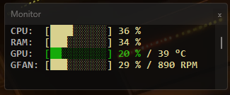

# 📊 System Resources Monitor

A lightweight, real-time Windows terminal dashboard written in C++ that monitors vital system telemetry with zero bloat and near-zero CPU/RAM overhead.

<p align="center">
  
</p>

## ✨ Highlights

- **Real-Time Telemetry**: Tracks CPU load, RAM allocation, GPU utilization, core temperature, and fan speed.
- **Hardware-Calibrated Fan Telemetry**: Displays both percentage and calculated RPM (calibrated against Nvidia RTX 2060 cooling curves).
- **Smooth Console Visualizer**: Custom terminal UI featuring Unicode block progress bars (`█`/`░`), animated transitions between telemetry updates, and dynamic threshold-based color coding (Green &rarr; Yellow &rarr; Orange &rarr; Critical Red).
- **Direct Win32 Console Controls**: Built on low-level Windows Console API (`GetStdHandle`, `COORD`, `CONSOLE_CURSOR_INFO`) for flicker-free rendering, persistent top placement, and cursor suppression.
- **Minimal Footprint**: Native C++ binary with no bulky runtime dependencies or heavy runtime wrappers.

---

## 🛠️ Architecture & Telemetry Pipeline

```
┌────────────────────────┐      ┌──────────────────────────┐      ┌──────────────────────────┐
│   SystemAnalizer       │      │   GuiManager             │      │   Win32 Console Host     │
│   - WMIC (CPU / RAM)   │ ───> │   - Step interpolation   │ ───> │   - Text attributes      │
│   - NVIDIA-SMI (GPU)   │      │   - Cache & progress bar │      │   - Flicker-free render  │
└────────────────────────┘      └──────────────────────────┘      └──────────────────────────┘
```

1. **Metrics Polling (`SystemAnalizer`)**: Queries CPU usage via WMI and queries GPU metrics directly via structured `nvidia-smi` queries (`utilization.gpu`, `temperature.gpu`, `fan.speed`).
2. **State & Display Engine (`GuiManager`)**: Parses raw telemetry, calculates interpolated intermediate step values for smooth animations, and applies Win32 console color attributes based on thermal and load safety thresholds (`CRITICAL = 80`).
3. **Screen Management**: Re-anchors cursor coordinates (`SetConsoleCursorPosition`) to eliminate full-screen clearing and console flicker.

---

## 💻 Requirements

- **Operating System**: Windows 10 / Windows 11 (Windows Console Host recommended)
- **Graphics Card**: NVIDIA GPU with `nvidia-smi` available in system PATH (calibrated for RTX 2060)
- **Compiler**: MinGW-w64 (`g++`) with standard Win32 libraries (`-lgdi32`)

---

## 🚀 Building & Running

### Using Automated Build Script

Run the automated compilation script from the repository root:

```bat
compile.bat
```

The script benchmarks compilation elapsed time using PowerShell deltas and automatically launches `Monitor.exe` upon completion.

### Manual Compilation

```cmd
g++ -g -I header source/*.cpp -o Monitor.exe -lgdi32
Monitor.exe
```

---

## 📄 License

This project is open-source under the [MIT License](LICENSE).
